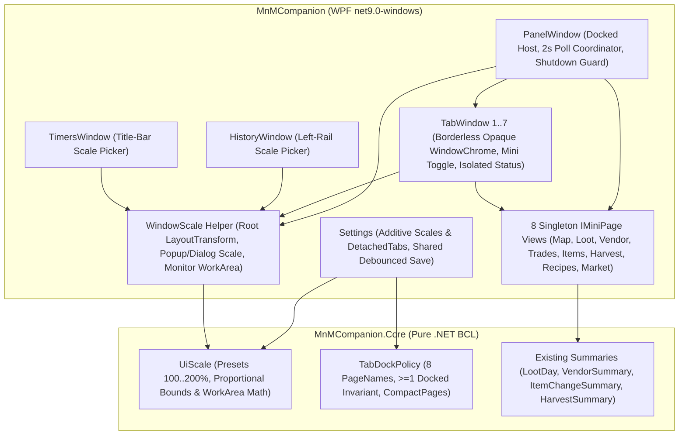
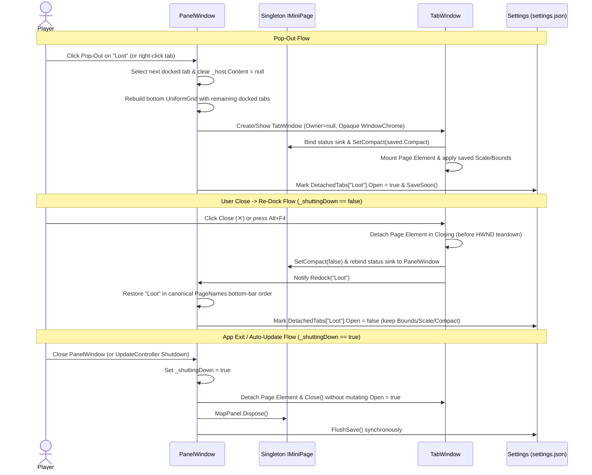

# Per-Window UI Scaling, Detachable Tab Windows, and Compact Overlay Mode

*   **Author:** @arapovp
*   **Status:** Approved
*   **Date:** 2026-11-10

--------------------------------------------------------------------------------

## Overview

`MnMCompanion` is a local, ledger-driven desktop overlay for *Monsters & Memories* that tracks live loot, vendor transactions, trades, item changes, harvests, zone maps, crafting recipes, and community market prices without reading game memory or hooking game input. Today, all 8 live feature tabs (`Map`, `Loot`, `Vendor`, `Trades`, `Items`, `Harvest`, `Recipes`, `Market`) sit inside a single fixed-font [`PanelWindow`](../../src/MnMCompanion/PanelWindow.cs) alongside [`TimersWindow`](../../src/MnMCompanion/TimersWindow.cs) and [`HistoryWindow`](../../src/MnMCompanion/HistoryWindow.xaml.cs).

This design introduces three coordinated capabilities:
1.  **Independent per-window UI scaling (`100%`–`200%`)** across `PanelWindow`, `HistoryWindow`, `TimersWindow`, and detached tab windows, scaling layout containers, fonts, menus, tooltips, child dialogs, and embedded map zoom proportionally while keeping windows inside visible monitor work areas.
2.  **Detachable persistent tab windows** that let players break any of the 8 bottom tabs out of `PanelWindow` (retaining at least one docked tab) into its own borderless overlay window that shares the followed character and session timeline, returns to `PanelWindow` when closed by the player, and reopens automatically across app restarts and updates.
3.  **Compact ("mini") overlay mode** on popped-out `Loot`, `Vendor`, `Items`, and `Harvest` windows, collapsing secondary headers and controls down to headline figures plus the top or latest 3 rows so players can keep a small live tracker over the game.

## The Problem

Players using `MnMCompanion` during live sessions hit three usability bottlenecks:

1.  **Unreadable text and controls on 4K and Linux Wine/Proton displays**: Base UI text (`10`–`12` px) and title-bar buttons (`26×26` px) are too small to read at arm's length on 4K monitors running at `100%`–`125%` OS scaling, and become microscopic under Linux Wine/Proton setups (Steam Proton, Lutris, UMU, XWayland, Gamescope) that report a flat `96` DPI regardless of physical monitor density. Because dense text tables (`Recipes`, `Loot`, `History`) need larger text than a graphical zone map (`Map`) or a small timer strip (`Timers`), one global scale setting wastes screen space on windows that do not need enlargement.
2.  **Single-tab lock-in prevents side-by-side play**: `PanelWindow` can display only one of its 8 bottom tabs at a time. A player navigating dungeons on the `Map` tab cannot watch live `Loot` splits, `Harvest` rates, or `Recipes` ingredients without tabbing back and forth over the game client.
3.  **Full tab chrome covers too much of the game viewport**: Even if `Loot`, `Vendor`, `Items`, or `Harvest` is broken out into a second window alongside `Map`, its full day/session selector, sub-tab strip, status bar, and tall scroll area occupy far more screen space than needed when a player only wants to glance at their coin split and top 3 drops.

## Goals

*   **Readable 4K and Wine/Proton UI**: Allow each top-level window (`PanelWindow`, `HistoryWindow`, `TimersWindow`, and each detached tab window) to scale independently through fixed presets (`100%`, `125%`, `150%`, `175%`, `200%`, plus `Ctrl`+`+`/`-`/`0`, persisted per window and defaulting to `100%`), resizing outer window dimensions proportionally within the active monitor's work area, scaling context menus, tooltips, and child dialogs from their parent window, and syncing embedded `Map` zoom to its host window's scale.
*   **Side-by-side multi-window layout**: Allow breaking out any of the 8 bottom tabs from `PanelWindow` into an independent, borderless, persistent overlay window (provided at least 1 tab remains docked in `PanelWindow`) that shares the active character and session scope, updates live on the same 2-second poll cycle without duplicate network fetches or browser processes, and keeps its own isolated status feedback.
*   **Predictable dock vs. exit lifecycle**: Re-dock a detached tab back into `PanelWindow` when the player closes that detached window (`✕` or `Alt+F4`), while closing all Companion windows—and preserving detached window positions, scales, pin states, and compact modes in `settings.json`—when `PanelWindow` exits or an automatic update restarts the app.
*   **Glanceable compact ("mini") overlays**: Provide an explicit compact-mode toggle button (plus double-click header restore) on popped-out `Loot`, `Vendor`, `Items`, and `Harvest` windows using Wine-safe vector icons, shrinking window height to fit (while remembering expanded height separately) and rendering fixed summaries:
    *   **Mini `Loot`**: Player's coin split + top 3 items by vendor worth looted across the whole party.
    *   **Mini `Vendor`**: Net vendor coin + top 3 sold items + top 3 bought items.
    *   **Mini `Items`**: Total item changes + log of the last 3 item changes (`Dropped`, `Picked up`, `Destroyed`).
    *   **Mini `Harvest`**: Gathered rate/count + top 3 gathered items by unit count.
*   **Safe multi-monitor recovery and local diagnostics**: Keep borderless windows and title-bar controls reachable across mixed-DPI multi-monitor setups, provide a one-click `"Reset window positions & scaling"` action in `PanelWindow`'s `ⓘ` menu, preserve downgrade-safe `settings.json` compatibility, and expose DPI, work-area, scale, and detached-window state in `--diagnose`, `--about`, and `--snapshot`.

## Non-Goals

*   **Compact mode outside the 4 personal summary tabs**: `Map`, `Trades`, `Recipes`, `Market`, and `PanelWindow` itself do not expose a 3-row compact toggle.
*   **OS input/window hooks or layered click-through**: `WS_EX_TRANSPARENT` click-through overlays, global Win32 hotkeys (`RegisterHotKey`), and `AllowsTransparency = true` layered detached windows (which blank `WebView2` map rendering) are excluded.
*   **Complex docking metaphors or third-party UI dependencies**: Drag-and-drop tab tear-off, docking multiple detached tabs together inside a secondary container window, and adding NuGet UI libraries (prohibited by [`LedgerOnlyTests.cs`](../../tests/MnMCompanion.Tests/LedgerOnlyTests.cs)) are out of scope.
*   **Independent character or session timelines per window**: Detached windows always follow the same character selection and `SessionScope` day/session as `PanelWindow`.
*   **Copying proprietary external code**: Inspiration from `DranakCorps-bot/EQBuddy` is strictly limited to clean-room UX patterns; zero proprietary `EQBuddy Evolved` (v2.0+) code, assets, or prose may be used.

## Open Questions

None.

## Critical User Journeys (CUJs)

### CUJ 1: Scaling Text-Heavy Windows on a 4K / 96-DPI Wine Display

*   **Given**: A player opens `MnMCompanion` on a 4K display (or a 96-DPI Linux Wine/Proton prefix) where `PanelWindow` (`Recipes` tab) and `HistoryWindow` render at default `100%` scale.
*   **When**: The player sets `PanelWindow` to `150%` scale, opens a skill filter menu and tooltip, opens `HistoryWindow` and sets its scale to `175%`, while leaving `TimersWindow` at `125%`.
*   **Then**: `PanelWindow` and `HistoryWindow` enlarge their text, controls, and outer dimensions proportionally without exceeding the active monitor's work area or pushing title-bar buttons off-screen; opened context menus, tooltips, and child dialogs render at their parent window's scale; `TimersWindow` stays at `125%`; and restarting `MnMCompanion` restores all three independent window scales.

### CUJ 2: Watching Map and Mini Loot Side by Side

*   **Given**: `PanelWindow` is docked with all 8 tabs on a single-character or party live session, and the player wants `Map` and `Loot` visible simultaneously over the game.
*   **When**: The player pops out the `Loot` tab into its own window, pins it on top, clicks its compact-mode button, and selects `Map` in `PanelWindow` (minimizing `PanelWindow` later during combat if desired).
*   **Then**: `Loot` disappears from `PanelWindow`'s bottom tab bar and opens beside `PanelWindow` as an independent borderless window; toggling compact mode hides `Loot`'s day/session bar and sub-tabs, shrinks the window height to fit the player's coin split plus the top 3 items looted across the party, and keeps updating every 2 seconds even if `PanelWindow` stays on `Map` or is minimized. Double-clicking the compact header (or clicking expand) restores `Loot`'s prior expanded height.

### CUJ 3: Re-Docking a Detached Tab vs. Exiting or Updating Companion

*   **Given**: `Loot` and `Harvest` are popped out as detached windows (with `Loot` in compact mode at `150%` scale), while the remaining 6 tabs stay docked in `PanelWindow` (and attempting to pop out the last remaining docked tab in `PanelWindow` is disabled with an explanatory tooltip).
*   **When**: The player clicks `✕` on the `Harvest` window, continues playing, and later closes `PanelWindow` (or `MnMCompanion` restarts for an automatic `--updated` release).
*   **Then**: Clicking `✕` on `Harvest` returns the `Harvest` tab to `PanelWindow`'s bottom bar in canonical tab order while remembering `Harvest`'s last detached bounds and scale; closing `PanelWindow` closes both `PanelWindow` and the still-detached `Loot` window without marking `Loot` as docked, so on the next launch `Loot` reopens automatically in compact mode at `150%` scale.

### CUJ 4: Recovering Off-Screen or Over-Scaled Windows Across Monitors

*   **Given**: A player previously positioned detached windows across a secondary monitor that has since been unplugged (or scaled a window to `200%` near a screen edge on a mixed 4K + 1080p setup).
*   **When**: `MnMCompanion` launches—or the player selects `ⓘ` -> `"Reset window positions & scaling"` in `PanelWindow`.
*   **Then**: On launch, every window clamps its position and dimensions into an active monitor's visible work area (never an unreachable multi-monitor dead zone); selecting `"Reset window positions & scaling"` returns `PanelWindow`, `HistoryWindow`, `TimersWindow`, and any open detached windows onto the primary monitor's work area at `100%` scale.

## Technical Plan (Architecture)

### System Component Topology

To preserve `MnMCompanion`'s strict dependency boundaries enforced by [`LedgerOnlyTests.cs`](../../tests/MnMCompanion.Tests/LedgerOnlyTests.cs) (`MnMCompanion.Core` uses only .NET BCL; `MnMCompanion.Tests` targets cross-platform `net9.0` without WPF), pure scaling math, tab-docking state normalization, and compact row-slicing live in `MnMCompanion.Core`, while WPF visual handoff, popup scaling, and Win32 monitor work-area queries live in `MnMCompanion`.

### 1. Pure-BCL Scaling, Docking, and Compact Projection Models (`MnMCompanion.Core`)

*   **`UiScale` (`MnMCompanion.Core/UiScale.cs`, modeled on [`TimerLook.cs`](../../src/MnMCompanion.Core/Timers/TimerLook.cs))**:
    *   Defines `Presets = [100, 125, 150, 175, 200]` and `Default = 100`.
    *   Provides `Nearest(int percent)`, `Clamp(int percent)`, `Next(int current)`, `Previous(int current)` (for `Ctrl`+`+`/`-`/`0`), and `Factor(int percent) -> double` (`1.0`–`2.0`).
    *   Computes proportional window bounds (`ResizeForScale` and `ClampToWorkArea`): when a window changes from `oldScale` to `newScale` inside monitor work area `(workLeft, workTop, workWidth, workHeight)`, outer `Width` and `Height` multiply by `newScale / oldScale` and effective `MinWidth`/`MinHeight` multiply by `Factor(newScale)`, both capped at `(workWidth, workHeight)`. `Left` and `Top` clamp so the entire top title bar (including right-aligned close, pin, compact, and scale buttons) remains inside `(workLeft..workRight, workTop..workBottom)`.
*   **`TabDockPolicy` (`MnMCompanion.Core/TabDockPolicy.cs`)**:
    *   Defines canonical `PageNames = ["Map", "Loot", "Vendor", "Trades", "Items", "Harvest", "Recipes", "Market"]` and `CompactPages = ["Loot", "Vendor", "Items", "Harvest"]`.
    *   Normalizes persisted state on startup and guards live UI transitions:
        1.  Ignores unknown tab names (forward-compatible with future tabs) and canonicalizes casing to `PageNames`.
        2.  Enforces `CanDetach(int dockedCount) => dockedCount > 1`. If all 8 tabs are marked open/detached in `settings.json`, force-docks `MiniPage` (if valid) or `"Loot"` by clearing only its `Open` flag while keeping its saved bounds, scale, pin, and compact settings intact.
        3.  If `MiniPage` names a currently detached tab, reassigns `MiniPage` to the first docked tab in `PageNames` order.
        4.  Clears `Compact = false` for any tab outside `CompactPages`.
*   **Fixed Compact Projections (reusing existing `MnMCompanion.Core` summaries)**:
    *   **Mini `Loot`**: Player's coin split from [`LootDay.Ours`](../../src/MnMCompanion.Core/Loot/LootBreakdown.cs#L115-L124) (`~` prefix when `EstimatedShares > 0`, click-to-copy preserved) + `LootDay.ItemsWorth.Take(3)` (top 3 items across the whole party ranked by vendor worth `Total`, then `Count`, then name).
    *   **Mini `Vendor`**: Net vendor coin from `VendorSummary.Totals(rows)` + `VendorSummary.ByItem(rows, VendorDirection.Sold).Take(3)` + `VendorSummary.ByItem(rows, VendorDirection.Bought).Take(3)`.
    *   **Mini `Items`**: Total item changes from `ItemChangeSummary.Totals(rows)` + `rows.OrderByDescending(r => r.Time).Take(3)`.
    *   **Mini `Harvest`**: Gathered rate (`PerHour` or total `Units`) from `HarvestSummary.Totals(rows)` + `HarvestSummary.ByItem(rows).Take(3)`.

### 2. Additive `settings.json` Schema and Coalesced Persistence (`Settings.cs`)

Existing properties (`Panel`, `Breakdown`, `Timers`, `MiniPage`, `View`, `OnTop`, `TimersOpen`, `TimersOnTop`, `TimersOpacity`) retain their exact JSON types and value ranges so rolling back to an older `MnMCompanion.exe` never produces `(0, 0, 0, 0)` bounds or `JsonException` resets.

New additive properties on [`Settings`](../../src/MnMCompanion/Settings.cs):
*   `int PanelScale { get; set; } = 100`
*   `int BreakdownScale { get; set; } = 100`
*   `int TimersScale { get; set; } = 100`
*   `Dictionary<string, DetachedTabState> DetachedTabs { get; set; } = []`
    *   `DetachedTabState`: `bool Open`, `Bounds? Bounds` (expanded outer DIPs; `null` until placed—never `NaN` or `Infinity`), `double? CompactHeight` (outer DIP height when compact; `null` until resized in compact mode), `int Scale = 100`, `bool OnTop = true`, `bool Compact = false`.

Persistence hygiene:
*   All windows share one `Settings.SaveSoon()` 1-second UI `DispatcherTimer` (replacing three separate `_saveSoon` timers across `PanelWindow`, `HistoryWindow`, and `TimersWindow`), plus `Settings.FlushSave()` on normal shutdown so multi-window move/scale bursts coalesce into one atomic write without Wine/Proton `File.Move` sharing collisions.
*   If `Settings.Load()` catches `JsonException`, it copies the unreadable file to `settings.json.corrupt` (best-effort) and records a load-recovery note for `--diagnose` rather than silently overwriting the file on next save.
*   Startup runs `TabDockPolicy` + `UiScale` normalization immediately after deserialization, and skips opening detached `TabWindow` overlays whenever `Settings.ReadOnly` is true (`--ledger`, `--snapshot`).

### 3. Proportional Window Scaling, Popups, Vector Icons, and Monitor Clamping (`WindowScale.cs`, `Ui.cs`, `Dialogs.cs`)

*   **Root `LayoutTransform` and Sharp Glyphs**: Each window wraps its root layout element in a host whose `LayoutTransform` is `Transform.Identity` with `TextFormattingMode.Display` at `100%`, switching to `new ScaleTransform(s, s)` with `TextFormattingMode.Ideal` when `s > 1.0`.
*   **Fixed Title Bar Outside `ScrollViewer` and Monitor Clamping**: Title bars sit outside scrollable body regions. On startup, scale change, and `LocationChanged`, `WindowScale` queries the nearest physical monitor's work area via Win32 `MonitorFromRect` / `GetMonitorInfo` (`user32.dll`, falling back to `SystemParameters.WorkArea` if unavailable) and clamps `MaxWidth`, `MaxHeight`, `MinWidth`, `MinHeight`, `Width`, `Height`, `Left`, and `Top` so windows cannot land in L-shaped 4K+1080p `VirtualScreen` dead zones or extend title-bar buttons off-screen at `200%`.
*   **Logical-Width Responsive Breakpoints**: [`PanelWindow.ShowToolLabels`](../../src/MnMCompanion/PanelWindow.cs#L266-L270), [`TimersWindow.ShowToolLabels`](../../src/MnMCompanion/TimersWindow.cs#L234-L238), and `HistoryWindow`'s period/filter bar evaluate effective logical width (`ActualWidth / scale`) so labels fold before right-aligned buttons clip.
*   **`ContextMenu`, `ToolTip`, and Child Dialog Scaling**: Because WPF `ContextMenu` and `ToolTip` open in separate Win32 `Popup` trees (including menus opened programmatically via `menu.IsOpen = true`), `WindowScale` registers static `EventManager.RegisterClassHandler` hooks on `ContextMenu.OpenedEvent` and `ToolTip.OpenedEvent` that resolve `PlacementTarget` to its owning `Window` and apply that window's `ScaleTransform` and `TextFormattingMode`. Child dialogs inherit their parent window's scale via [`Dialogs.Dress`](../../src/MnMCompanion/Dialogs.cs#L14-L28) (`SuggestionWindow`, `WhatsNewWindow`) and explicit `WindowScale` attachment in [`ShareWindow`](../../src/MnMCompanion/ShareWindow.cs) and [`TimerSetupWindow`](../../src/MnMCompanion/TimerSetupWindow.cs).
*   **Scale Controls and Wine-Safe Vector `Path` Icons**:
    *   `PanelWindow`, `TimersWindow`, and `TabWindow` expose a title-bar scale button (`Text size`, opening the `100%`–`200%` preset menu); `HistoryWindow` exposes a matching `Text size` button in its top left-rail `StackPanel` beneath `CharacterButton` ([`HistoryWindow.xaml`](../../src/MnMCompanion/HistoryWindow.xaml#L27-L35)). Every scalable window also handles `Ctrl`+`Plus`/`=`, `Ctrl`+`Minus`, and `Ctrl`+`0`.
    *   All new buttons (`Pop out tab`, `Return to main window`, `Mini view` / `Full view`, `Text size`) render native WPF `Path` vector geometry in `Ui.cs` rather than font glyphs or Unicode dingbats that fail to render in Linux Wine prefixes.

### 4. Detached `TabWindow`, Singleton Visual Handoff, `WebView2` Sync, and Poll Coordination (`PanelWindow.cs`, `TabWindow.cs`, `MapPanel.cs`)

*   **`IMiniPage` Decoupling**:
    *   Replaces the shared `TextBlock _status` constructor parameter across all 8 pages with a per-page mutable status sink (`Action<string>` / `StatusLine` per window) so `PanelWindow` and each `TabWindow` show only their own copy confirmations, backoff notices, and ledger/SQLite errors (preserving a 1-line error indicator even when compact mode is active).
    *   Adds `bool SupportsCompact` (`true` on `LootPanel`, `VendorMini`, `ItemsMini`, `HarvestMini`) and `void SetCompact(bool compact)`.
*   **`TabWindow` Chrome and Separate Compact Height**:
    *   Uses `PanelWindow`'s opaque `WindowChrome` (`AllowsTransparency = false`, `Owner = null`, `ShowInTaskbar = false`) so minimizing `PanelWindow` keeps pinned detached windows over the game and `WebView2` renders without layered-window airspace conflicts.
    *   Title bar displays `<Tab> · <Character · Server>` (plus a clickable scope chip such as `"Yesterday"` when `SessionScope` is viewing a past day or closed session while `SessionHeader` is hidden in compact mode), right-aligned controls (`Text size`, `Mini`/`Expand` when `SupportsCompact`, `Pin`, and `✕` `"Return to main window"`), and double-click on the compact header to restore full view.
    *   Toggling `Compact = true` saves current expanded `Bounds`, lowers unscaled `MinHeight` from `240` to `96`, hides secondary page chrome (`SessionHeader`, sub-tab bar, filter box, copy bar), and applies saved `CompactHeight` (or measures compact content height on first toggle); toggling `Compact = false` restores expanded `Height` and `MinHeight = 240`.
*   **`MapPanel` (`WebView2`) Scale and Reparenting Safety**:
    *   `MapPanel` adds `SetHostScale(double scale)` which sets `_web.ZoomFactor = scale` whenever `_ready && _settings.MapsOnline` (and applies it at the end of `StartAsync()`), syncing zoom whenever the host window scales or `MapPanel` moves between `PanelWindow` and `TabWindow`.
    *   Transient exceptions during `ZoomFactor` updates or navigation no longer latch `_failed = true` for the rest of the process; `MapPanel` shows the exception type/reason alongside a `"Try again"` action and subscribes to `CoreWebView2.ProcessFailed` for clean recovery.
*   **Centralized 2-Second Refresh and SQLite Guard**:
    *   `PanelWindow` remains the sole owner of `_timer` (2-second poll), `FollowAsync`, `RefreshAsync`, and `ChooseRoot`, iterating across `PanelWindow.Active` **and every open `TabWindow`** to refresh views, update title-bar character labels, route `SessionScope.Said`, and invoke `_history.RefreshAsync()` at most once per tick when any visible page has `NeedsHistory == true`.
    *   [`StatsPanel<T>.LoadAsync`](../../src/MnMCompanion/MiniPages.cs#L127-L138) re-checks `generation != _generation` inside `Task.Run` before acquiring `LedgerDb`'s single-connection lock so rapid day-arrow clicks across multiple open stats windows drop stale queries immediately.

### 5. Recovery Menu and Local CLI Diagnostics (`PanelWindow.cs`, `App.xaml.cs`, `GameFolderFinder.cs`)

*   **Recovery Controls**: `PanelWindow`'s `ⓘ` menu (`OpenAboutMenu`, kept visible even when `updates` is `null` by omitting only update-specific items) adds `"Bring all tabs back"` (enabled when any tab is detached) and `"Reset window positions & scaling"` (re-docking or moving all windows onto the primary monitor's work area at `100%` scale). `PanelWindow` also places a visible vector-`Path` `"Pop out tab"` button beside the active tab (plus right-click on bottom-bar tab buttons), disabled with tooltip `"At least one tab stays in the main Companion window"` when only 1 tab remains docked.
*   **`--diagnose`, `--about`, and `--snapshot`**:
    *   [`DiagnoseFacts`](../../src/MnMCompanion.Core/Ledger/GameFolderFinder.cs#L156-L159) and `GameFolderFinder.Report` accept pure-BCL display and layout strings reporting `PixelsPerDip`, primary/virtual work areas, Linux display env vars (`DISPLAY`, `WAYLAND_DISPLAY`, `GAMESCOPE_WAYLAND_DISPLAY`), `settings.json` recovery status, per-window scales, and sanitized detached/compact tab states (never character names). `--about` appends a summary line for window scales and detached tabs.
    *   [`Args`](../../src/MnMCompanion/App.xaml.cs#L597-L610) and `App.Snapshot` add `--scale <percent>`, `--popout <page>`, and `--compact` options (always under `Settings.ReadOnly = true`) and emit `<png>.txt` geometry/scale/DPI sidecar files across `PanelWindow`, `HistoryWindow`, `TimersWindow`, and `TabWindow`.

## Alternatives Considered

### Alternative A: Scaling `FontSize` Only Without Root `LayoutTransform` or Outer Window Resize

*   **Pros**: Avoids changing window bounds or switching `TextFormattingMode` off `Display` above `100%`.
*   **Cons**: Fixed pixel containers across the codebase (`Height = 32` title bars, `26×26` icon buttons, fixed `Col<T>.Width` table columns in [`Ui.cs`](../../src/MnMCompanion/Ui.cs), skill badges in [`RecipesPanel.cs`](../../src/MnMCompanion/RecipesPanel.cs)) clip enlarged text while leaving button hit targets tiny at 96 DPI under Wine/Proton.
*   **Reason for Rejection**: Fails to scale controls, spacing, and column widths alongside text, and requires error-prone manual font arithmetic in every control.

### Alternative B: One Global `UiScale` Shared by Every Window

*   **Pros**: Stores one integer in `settings.json` and exposes a single scale menu inside `PanelWindow`.
*   **Cons**: Forces graphical or compact windows (`Map`, `Timers`, Mini `Loot`) to grow by the same factor needed for dense text browsers (`Recipes`, `Market`, `HistoryWindow`), covering game viewport area that did not need enlargement.
*   **Reason for Rejection**: Per-window scale presets (`100%`–`200%`) add minimal state while letting players enlarge dense text tables without bloating maps or timers.

### Alternative C: Instantiating Duplicate `IMiniPage` Views for Detached Windows

*   **Pros**: Avoids clearing `ContentControl.Content = null` when moving a page between `PanelWindow` and `TabWindow`.
*   **Cons**: Instantiating a second `MapPanel` spawns a second `~150`–`300` MB `CoreWebView2` browser process tree and collides on the `<StateRoot>\webview` profile lock (`COMException`); duplicating `RecipesPanel` or `MarketPanel` splits ETag/rate-limit state across instances; and recreating pages discards typed search queries and selected sub-tabs on every pop-out or re-dock.
*   **Reason for Rejection**: Singleton handoff preserves user filter/scroll state, adds zero browser or network overhead, and prevents `WebView2` user-data lock failures.

### Alternative D: Dedicated Loot-Only Mini Overlay Instead of Detachable Bottom Tabs

*   **Pros**: Avoids dynamic bottom-bar column updates and multi-tab `DetachedTabs` state.
*   **Cons**: Leaves players unable to view `Map` alongside `Recipes`, `Market`, `Harvest`, `Vendor`, or `Items`, and duplicates overlay chrome in a one-off window class.
*   **Reason for Rejection**: A single `TabWindow` class handles detaching any of the 8 tabs while limiting compact 3-row summaries to the 4 tabs whose domain models fit fixed summaries (`Loot`, `Vendor`, `Items`, `Harvest`).

### Alternative E: Third-Party WPF Docking Package or `AllowsTransparency = true` Layered Detached Windows

*   **Pros**: Offloads tab tear-off chrome or allows background-only alpha fading behind text.
*   **Cons**: [`LedgerOnlyTests.cs`](../../tests/MnMCompanion.Tests/LedgerOnlyTests.cs#L72-L84) prohibits adding NuGet packages to `MnMCompanion.csproj` beyond `Microsoft.Web.WebView2`, and `AllowsTransparency = true` layered windows blank Win32 `HwndHost` (`WebView2`) rendering on `MapPanel`.
*   **Reason for Rejection**: Violates repository dependency rules and breaks embedded map rendering.

--------------------------------------------------------------------------------

## Non-Functional Requirements

*   **Security & Privacy**:
    *   Zero new NuGet dependencies, outbound network hosts, or process/memory/input APIs ([`LedgerOnlyTests.cs`](../../tests/MnMCompanion.Tests/LedgerOnlyTests.cs) passes unmodified).
    *   `MapPanel` continues to block `CoreWebView2` creation and `mnmatlas.com` requests until `Settings.MapsOnline` is enabled by the player.
    *   `--diagnose` and `--about` output only numeric DPI/work-area/scale values and canonical tab names—never character or player names—while preserving [`GameFolderFinder.Mask`](../../src/MnMCompanion.Core/Ledger/GameFolderFinder.cs#L124-L127) path redaction.
    *   Clean-room implementation: zero code, assets, or documentation copied from proprietary `EQBuddy Evolved` (v2.0+, `LICENSE-EVOLVED.md`).
*   **Performance & Latency**:
    *   Zero additional polling timers: `PanelWindow`'s single 2-second `DispatcherTimer` refreshes `PanelWindow.Active` and open `TabWindow`s, invoking `_history.RefreshAsync()` at most once per cycle.
    *   `StatsPanel<T>.LoadAsync` drops superseded `_generation` requests before acquiring `LedgerDb`'s single-connection `lock (_gate)`.
    *   All windows coalesce geometry and scale writes onto one shared 1-second debounced `Settings.SaveSoon()` timer flushed once on exit.
*   **Rollout & Rollback**:
    *   All scales default to `100%` (`Transform.Identity`, `TextFormattingMode.Display`) and `DetachedTabs` defaults to empty, preventing surprise layout shifts after unattended `--updated` restarts and keeping existing `--snapshot` baselines unchanged at `100%`.
    *   Existing `settings.json` keys keep their exact JSON types with zero `NaN`/`Infinity` tokens, allowing downgrade to an older `MnMCompanion.exe` without resetting user settings (note: if `Map` was left scaled `> 100%` before downgrading, Chromium's cached origin zoom in `<StateRoot>\webview` persists until reset or folder removal).

--------------------------------------------------------------------------------

### Additional Resources

*   Repository architectural contracts: [EGM.md](../../EGM.md), [src/MnMCompanion/EGM.md](../../src/MnMCompanion/EGM.md), [src/MnMCompanion.Core/EGM.md](../../src/MnMCompanion.Core/EGM.md), [src/MnMCompanion.Core/Ledger/EGM.md](../../src/MnMCompanion.Core/Ledger/EGM.md)
*   Player documentation: [FAQ.md](../FAQ.md), [ledger-notes.md](../ledger-notes.md)
*   Clean-room UX reference (MIT `v1.99.18` docs): `DranakCorps-bot/EQBuddy` (`LEGACY-V1.md` / `docs/FeatureGuide.md`)

### Future Improvements

*   **Optional whole-window opacity on non-`Map` detached overlays**: If players want faded HUD backgrounds on compact `Loot` or `Harvest` windows without using `AllowsTransparency = true`, `Window.Opacity` presets could be exposed on non-`Map` `TabWindow`s in a follow-up.

--------------------------------------------------------------------------------

## Detailed Implementation Plan

### Target Files to Create/Modify

#### Phase 1: Pure-BCL Scaling, Docking, and Diagnostics (`MnMCompanion.Core` & `MnMCompanion.Tests`)

1.  **`src/MnMCompanion.Core/UiScale.cs` (`[CREATE]`)**
    *   **Purpose**: Provides pure-BCL window scale presets, step navigation, and monitor work-area geometry calculations (`namespace MnMCompanion`) testable under cross-platform `net9.0`.
    *   **Public API Contract**:
        *   `public readonly record struct WorkArea(double Left, double Top, double Width, double Height)` with `double Right => Left + Width` and `double Bottom => Top + Height`.
        *   `public readonly record struct WindowBox(double Left, double Top, double Width, double Height, double MinWidth, double MinHeight)`.
        *   `public static class UiScale`:
            *   `public static readonly IReadOnlyList<int> Presets = [100, 125, 150, 175, 200]`
            *   `public const int Default = 100`, `public const int Min = 100`, `public const int Max = 200`
            *   `public static int Clamp(int percent) -> int` (clamps input to `[100, 200]`).
            *   `public static int Nearest(int percent) -> int` (snaps `Clamp(percent)` to the closest preset in `Presets`, breaking midpoint ties toward the lower preset).
            *   `public static int Next(int current) -> int` and `public static int Previous(int current) -> int` (steps one preset up or down from `Nearest(current)`, saturating at `200` and `100`).
            *   `public static double Factor(int percent) -> double` (`Nearest(percent) / 100.0`).
            *   `public static WindowBox ClampToWorkArea(double left, double top, double width, double height, double baseMinWidth, double baseMinHeight, int scalePercent, WorkArea work) -> WindowBox`:
                1.  Computes `s = Factor(scalePercent)`, `minW = Math.Min(baseMinWidth * s, work.Width)`, and `minH = Math.Min(baseMinHeight * s, work.Height)`.
                2.  Clamps `w = Math.Clamp(width, minW, work.Width)` and `h = Math.Clamp(height, minH, work.Height)`.
                3.  Clamps `l = Math.Clamp(left, work.Left, Math.Max(work.Left, work.Right - w))` and `t = Math.Clamp(top, work.Top, Math.Max(work.Top, work.Bottom - h))` so the full top title bar and right-aligned buttons stay inside `work`.
            *   `public static WindowBox ResizeForScale(double left, double top, double width, double height, double baseMinWidth, double baseMinHeight, int oldScalePercent, int newScalePercent, WorkArea work) -> WindowBox`:
                1.  Computes `ratio = Factor(newScalePercent) / Factor(oldScalePercent)`.
                2.  Delegates `(left, top, width * ratio, height * ratio, baseMinWidth, baseMinHeight, newScalePercent, work)` to `ClampToWorkArea`.

2.  **`src/MnMCompanion.Core/TabDockPolicy.cs` (`[CREATE]`)**
    *   **Purpose**: Enforces canonical tab ordering, the `>= 1` docked-tab invariant, and compact-mode eligibility (`namespace MnMCompanion`) without WPF dependencies.
    *   **Public API Contract**:
        *   `public sealed record TabSlot(string Name, bool Open, int Scale, bool OnTop, bool Compact)`
        *   `public sealed record NormalizedTabs(string ActiveDockedPage, IReadOnlyDictionary<string, TabSlot> Tabs)`
        *   `public static class TabDockPolicy`:
            *   `public static readonly IReadOnlyList<string> PageNames = ["Map", "Loot", "Vendor", "Trades", "Items", "Harvest", "Recipes", "Market"]`
            *   `public static readonly IReadOnlyList<string> CompactPages = ["Loot", "Vendor", "Items", "Harvest"]`
            *   `public static bool IsKnownPage(string? name, out string canonical) -> bool` (`OrdinalIgnoreCase` lookup into `PageNames`).
            *   `public static bool SupportsCompact(string? pageName) -> bool` (`OrdinalIgnoreCase` lookup into `CompactPages`).
            *   `public static bool CanDetach(int dockedCount) -> bool` (`dockedCount > 1`).
            *   `public static IReadOnlyList<string> DockedPages(IReadOnlyDictionary<string, TabSlot> tabs) -> IReadOnlyList<string>` (treats absent `PageNames` keys in sparse `tabs` as docked via `!tabs.TryGetValue(p, out var s) || !s.Open`, preserving `PageNames` order).
            *   `public static string NextDockedPage(IReadOnlyList<string> dockedBeforeDetach, string detachingPage) -> string` (returns the next item in `dockedBeforeDetach` after `detachingPage`, or the preceding item when detaching the last item).
            *   `public static NormalizedTabs Normalize(string? miniPage, IReadOnlyDictionary<string, TabSlot>? raw) -> NormalizedTabs`:
                1.  Keeps `Tabs` sparse: discards keys failing `IsKnownPage`, canonicalizes matching keys to `PageNames` casing, and resolves case-insensitive duplicate keys deterministically by preferring any entry with `Open == true` (else the first key in `StringComparer.Ordinal` order).
                2.  Normalizes each slot's `Scale` via `UiScale.Nearest(slot.Scale)` and forces `Compact = false` when `!SupportsCompact(canonical)`.
                3.  Resolves `preferred = IsKnownPage(miniPage, out var p) ? p : "Loot"`.
                4.  If all 8 `PageNames` have `Open == true`, rewrites `Tabs[preferred]` with `Open = false` while preserving `Scale`, `OnTop`, and `Compact`.
                5.  Computes `docked = DockedPages(Tabs)` and sets `ActiveDockedPage = docked.Contains(preferred) ? preferred : docked[0]`.

3.  **[`src/MnMCompanion.Core/Ledger/GameFolderFinder.cs`](../../src/MnMCompanion.Core/Ledger/GameFolderFinder.cs) (`[MODIFY]`)**
    *   **Purpose**: Exposes display DPI/work-area and sanitized window/tab layout state in `--diagnose` without breaking existing positional `DiagnoseFacts` callers.
    *   **Changes**:
        *   Appends two optional trailing parameters to [`DiagnoseFacts`](../../src/MnMCompanion.Core/Ledger/GameFolderFinder.cs#L156-L159): `string? Display = null, string? Windows = null`.
        *   Updates [`GameFolderFinder.Report(DiagnoseFacts f)`](../../src/MnMCompanion.Core/Ledger/GameFolderFinder.cs#L130-L150) to emit `Line($"display: {f.Display}");` when `!string.IsNullOrWhiteSpace(f.Display)` and `Line($"windows: {f.Windows}");` when `!string.IsNullOrWhiteSpace(f.Windows)` immediately after `Line($"the map's web view: {f.WebView}");` (reusing `Report`'s local `Line` helper, which applies `Mask`).

4.  **`tests/MnMCompanion.Tests/UiScaleTests.cs` (`[CREATE]`)**
    *   **Purpose**: Unit-tests `UiScale` preset snapping, keyboard stepping, proportional outer resizing, 96-DPI 4K (`3840×2160`) vs. 200%-OS-DPI (`1920×1080` DIP) work-area clamping, negative secondary-monitor coordinates (`Left = -1920`), and title-bar reachability at `200%`.

5.  **`tests/MnMCompanion.Tests/TabDockPolicyTests.cs` (`[CREATE]`)**
    *   **Purpose**: Unit-tests `TabDockPolicy` canonical order, sparse-dictionary `DockedPages`, `CanDetach`, `NextDockedPage`, startup repair when all 8 tabs are persisted open (verifying `Scale`, `OnTop`, and `Compact` survive), `ActiveDockedPage` reassignment when `MiniPage` is detached, case-insensitive duplicate-key resolution, unknown-key stripping, and `Compact = false` enforcement on `Map`, `Trades`, `Recipes`, and `Market`.

6.  **`tests/MnMCompanion.Tests/CompactSummaryTests.cs` (`[CREATE]`)**
    *   **Purpose**: Unit-tests the 4 compact projections directly against `MnMCompanion.Core` domain summaries across multi-player, empty, and `< 3` item datasets:
        *   Mini `Loot`: `LootDay.Ours.Copper` (`EstimatedShares > 0` prefix logic) and `LootDay.ItemsWorth.Take(3)` ranking drops across the entire party rather than personal-only drops.
        *   Mini `Vendor`: `VendorSummary.Totals(rows).Net`, `VendorSummary.ByItem(rows, VendorDirection.Sold).Take(3)`, and `VendorSummary.ByItem(rows, VendorDirection.Bought).Take(3)`.
        *   Mini `Items`: `ItemChangeSummary.Totals(rows)` and `rows.OrderByDescending(r => r.Time).Take(3)` across `Dropped`, `PickedUp`, and `Destroyed`.
        *   Mini `Harvest`: `HarvestSummary.Totals(rows)` (`PerHour` vs. `< 1 minute` `Units`) and `HarvestSummary.ByItem(rows).Take(3)`.

7.  **[`tests/MnMCompanion.Tests/GameFolderFinderTests.cs`](../../tests/MnMCompanion.Tests/GameFolderFinderTests.cs) (`[MODIFY]`)**
    *   **Purpose**: Adds tests verifying `GameFolderFinder.Report` omits `display:` and `windows:` lines when `null` and formats + path-redacts them via `GameFolderFinder.Mask` when populated.

#### Phase 2: Additive Settings Persistence, Vector Icons, and Shared WPF Window Scaling (`MnMCompanion`)

8.  **[`src/MnMCompanion/Settings.cs`](../../src/MnMCompanion/Settings.cs) (`[MODIFY]`)**
    *   **Purpose**: Persists per-window scales and detached tab states additively while coalescing multi-window disk writes and preserving corrupt files for diagnosis.
    *   **Changes**:
        *   Adds `public sealed record DetachedTabState` with mutable properties `bool Open { get; set; }`, `Bounds? Bounds { get; set; }`, `double? CompactHeight { get; set; }`, `int Scale { get; set; } = UiScale.Default`, `bool OnTop { get; set; } = true`, and `bool Compact { get; set; }`.
        *   Adds defaulted properties on `Settings`: `int PanelScale { get; set; } = UiScale.Default`, `int BreakdownScale { get; set; } = UiScale.Default`, `int TimersScale { get; set; } = UiScale.Default`, `Dictionary<string, DetachedTabState> DetachedTabs { get; set; } = []`, and `[JsonIgnore] public string? LoadNote { get; private set; }`.
        *   Adds `public void Normalize()` called at the end of `Settings.Load()`:
            1.  Snaps `PanelScale`, `BreakdownScale`, and `TimersScale` via `UiScale.Nearest`.
            2.  Sanitizes `Panel`, `Breakdown`, `Timers`, and each `DetachedTabState.Bounds`: replaces any `Bounds` whose `Left`, `Top`, `Width`, or `Height` fails `double.IsFinite` or has `Width <= 0 || Height <= 0` with `null`; replaces any `CompactHeight` failing `double.IsFinite` or `<= 0` with `null`.
            3.  Applies `TabDockPolicy.Normalize(MiniPage, ...)` to canonicalize `DetachedTabs` keys, repair any all-8-open state without discarding `Bounds` or `CompactHeight`, and update `MiniPage`.
        *   In `Settings.Load()`, when `JsonException` is caught, copies the unreadable file to `settings.json.corrupt` (`overwrite: true`, catching `IOException` / `UnauthorizedAccessException`) and sets `LoadNote = "settings.json was unreadable (backed up to settings.json.corrupt)"`.
        *   Adds `public void SaveSoon()` (single shared 1-second UI `DispatcherTimer` `_saveSoon` on `Settings`, no-op when `ReadOnly`), updates `Save()` to stop `_saveSoon` if running, and adds `public void FlushSave()` which stops `_saveSoon` and calls `Save()` **only** when `_saveSoon` had a pending write (`_saveSoon is { IsEnabled: true }`), preventing accidental disk writes during read-only or diagnostic CLI runs.

9.  **[`src/MnMCompanion/Ui.cs`](../../src/MnMCompanion/Ui.cs) (`[MODIFY]`)**
    *   **Purpose**: Supplies Wine-safe WPF vector `Path` icons so new title-bar and tab controls never depend on `Segoe MDL2 Assets` or missing symbol fonts.
    *   **Changes**:
        *   Adds `internal static class Icons` with factory methods returning `UIElement` (`Path` with `Stretch = Stretch.Uniform`, `Width = 12`, `Height = 12`, `StrokeThickness = 1.4`, `SnapsToDevicePixels = true`, `Stroke` bound to ancestor `Control.Foreground`):
            *   `PopOut()` (box with outward top-right arrow),
            *   `Compact()` (inward vertical chevrons),
            *   `Expand()` (outward vertical chevrons),
            *   `TextSize()` (dual-height `"Aa"` vector strokes),
            *   `Pin()` and `Close()` (`✕` strokes for `TabWindow` title-bar controls).

10. **`src/MnMCompanion/WindowScale.cs` (`[CREATE]`)**
    *   **Purpose**: Centralizes root `LayoutTransform` application, `TextFormattingMode` switching, Win32 per-monitor work-area queries, popup/dialog scaling, and keyboard/menu scale controls across all WPF windows.
    *   **Contract**:
        *   `internal sealed class WindowScale`:
        *   Static constructor registers `EventManager.RegisterClassHandler` on `ContextMenu.OpenedEvent` and `ToolTip.OpenedEvent`:
            *   `ContextMenu.OpenedEvent` resolves `PlacementTarget` (falling back to `Mouse.DirectlyOver as DependencyObject`) via `Window.GetWindow`, looks up `ScaleOf(owner)`, stores that resolved integer scale in an attached property on the `ContextMenu`, and applies `LayoutTransform` (`Transform.Identity` at `100%`, `new ScaleTransform(s, s)` above `100%`) plus `TextOptions.SetTextFormattingMode(..., s > 1.0 ? Ideal : Display)`.
            *   `ToolTip.OpenedEvent` resolves `Window.GetWindow(target)` first and falls back to any logical/visual ancestor `ContextMenu`'s attached scale so menu-item tooltips inside open `ContextMenu` popups scale alongside their parent menu.
        *   Exposes `public static void SetOffScreenSnapshot(Window window, bool enabled = true)` (attached `DependencyProperty`) so `App.Snapshot` can mark any target window off-screen before `Show()` without adding snapshot parameters to window constructors.
        *   `public static WindowScale Attach(Window window, FrameworkElement rootContent, double baseMinWidth, double baseMinHeight, int initialPercent, Action<int>? onChanged = null) -> WindowScale`:
            *   Wraps `rootContent` in a `Decorator` assigned to `window.Content`, stores `WindowScale` on `window` (`ScaleOf(Window?) -> int`), and applies initial transform without resizing saved outer bounds (`resizeOuter: false`).
            *   Attaches `SourceInitialized`, `LocationChanged`, and bubbling `Window.KeyDown` (ignoring events where `e.Handled == true` so `TimerSetupWindow.KeyBox.PreviewKeyDown` captures timer hotkeys first, then mapping `Ctrl`+`OemPlus`/`Add` -> `UiScale.Next`, `Ctrl`+`OemMinus`/`Subtract` -> `UiScale.Previous`, and `Ctrl`+`D0`/`NumPad0` -> `UiScale.Default` when `Keyboard.Modifiers == ModifierKeys.Control`).
        *   `public static void AttachDialog(Window window, double baseWidth, double baseMaxHeight, int percent)`:
            *   Designed for `SizeToContent = SizeToContent.Height` (`NoResize`) child dialogs (`Dialogs.Dress`, `ShareWindow`) invoked inside `SourceInitialized` after `window.Content` is assigned.
            *   Wraps `(FrameworkElement)window.Content` in a `Decorator` immediately, stores `percent` for `ScaleOf(window)`, applies `ScaleTransform` and `TextFormattingMode`, and sets `window.Width = Math.Min(baseWidth * s, work.Width - 24)` and `window.MaxHeight = Math.Min(baseMaxHeight * s, work.Height - 24)` (unless `GetOffScreenSnapshot(window)` is `true`) without writing `Height` or `MinHeight` or binding `KeyDown` scale shortcuts.
        *   `public static WorkArea WorkAreaFor(Window window) -> WorkArea` and `public static WorkArea WorkAreaForRect(double left, double top, double width, double height, Visual? dpiReference) -> WorkArea`:
            *   Calls Win32 `MonitorFromRect` (`MONITOR_DEFAULTTONEAREST = 2`) and `GetMonitorInfoW` (`user32.dll`), converting physical monitor `rcWork` pixels to WPF DIPs via `VisualTreeHelper.GetDpi(dpiReference).PixelsPerDip` (falling back to `SystemParameters.WorkArea` when `HWND` is not yet created or P/Invoke fails).
        *   `public void SetScale(int percent, bool resizeOuter = true)`:
            *   Snaps `percent` via `UiScale.Nearest`, updates `Decorator.LayoutTransform` and `TextFormattingMode`, skips monitor clamping when `GetOffScreenSnapshot(window)` is `true`, otherwise resolves any `double.IsNaN` `Width`/`Height` via `ActualWidth`/`ActualHeight` (or `baseMinWidth`/`baseMinHeight`) and any `double.IsNaN` `Left`/`Top` by centering within `work`, computes `UiScale.ResizeForScale` (`resizeOuter && WindowState == Normal`) or `UiScale.ClampToWorkArea`, updates `MaxWidth`, `MaxHeight`, `MinWidth`, `MinHeight`, `Width`, `Height`, `Left`, and `Top` under a re-entrancy guard, and invokes `onChanged`.
        *   `public void SetBaseMinSize(double baseMinWidth, double baseMinHeight, double? targetOuterHeight = null)`: updates unscaled minimums and re-clamps outer dimensions to the current monitor's `WorkArea`.
        *   `public Button MakeTitleButton(Style iconButtonStyle) -> Button` and `public void OpenMenu(UIElement anchor)`: opens a `ContextMenu` listing `100% (default)`, `125%`, `150%`, `175%`, and `200%` with a checkmark on `Percent`.

11. **[`src/MnMCompanion/Dialogs.cs`](../../src/MnMCompanion/Dialogs.cs), [`src/MnMCompanion/ShareWindow.cs`](../../src/MnMCompanion/ShareWindow.cs), and [`src/MnMCompanion/TimerSetupWindow.cs`](../../src/MnMCompanion/TimerSetupWindow.cs) (`[MODIFY]`)**
    *   **Purpose**: Propagates parent window scale to all 4 child/modal dialogs (`SuggestionWindow`, `WhatsNewWindow`, `ShareWindow`, `TimerSetupWindow`) while preserving `SizeToContent.Height` on auto-sized dialogs and snapshot compatibility on `TimerSetupWindow`.
    *   **Changes**:
        *   `Dialogs.Dress(Window w, string title, double width)`: in its `SourceInitialized` handler (which runs after `SuggestionWindow` and `WhatsNewWindow` assign `w.Content`), resolves `percent = WindowScale.ScaleOf(w.Owner)` and calls `WindowScale.AttachDialog(w, width, baseMaxHeight: 780, percent)`.
        *   `ShareWindow`: in its `SourceInitialized` handler, resolves `percent = Owner is not null ? WindowScale.ScaleOf(Owner) : _settings.PanelScale` and calls `WindowScale.AttachDialog(this, baseWidth: 520, baseMaxHeight: 900, percent)`, preserving `SizeToContent.Height` when `"What is shared ▾"` unfolds or async `Prepare()` populates `_preview`.
        *   `TimerSetupWindow`: attaches `WindowScale.Attach(this, root, baseMinWidth: 580, baseMinHeight: 420, initialPercent: settings.TimersScale, onChanged: p => { settings.TimersScale = p; settings.SaveSoon(); })` and scales initial `Width` (`660 * s`) and `Height` (`700 * s`) without setting `Owner` in the constructor (avoiding `InvalidOperationException` when `App.Snapshot` constructs `TimersWindow` unshown).

#### Phase 3: `IMiniPage` Decoupling, Compact Projections, `TabWindow`, and Host Window Integration (`MnMCompanion`)

12. **[`src/MnMCompanion/SessionScope.cs`](../../src/MnMCompanion/SessionScope.cs) (`[MODIFY]`)**
    *   **Purpose**: Exposes live-session state and a quick `"Today"` reset in the session menu so compact `TabWindow` overlays can display and reset historical/whole-day scopes while `SessionHeader` is hidden.
    *   **Changes**:
        *   Adds `public bool IsLiveDefault => Day == Today && (!_wholeDay || store.Sessions.Marks.Count == 0) && (_scopeStart is null || ActiveSession() is { Open: true });`.
        *   In `OpenMenu(Button anchor)`, prepends `"Back to today (current session)"` (calling `Reset()`) whenever `Day != Today`.

13. **[`src/MnMCompanion/MiniPages.cs`](../../src/MnMCompanion/MiniPages.cs) (`[MODIFY]`)**
    *   **Purpose**: Decouples status reporting across windows, guards `LedgerDb` against stale concurrent day-step queries, and implements compact mode on `VendorMini`, `ItemsMini`, and `HarvestMini`.
    *   **Changes**:
        *   Updates `IMiniPage` signature to add `bool SupportsCompact { get; }`, `void SetCompact(bool compact)`, and `void BindStatus(Action<string> say)` (removing `TextBlock status` from `StatsPanel<T>`, `VendorMini`, `TradesMini`, `ItemsMini`, and `HarvestMini` constructors).
        *   Updates [`StatsPanel<T>`](../../src/MnMCompanion/MiniPages.cs#L37-L204):
            *   Stores `private Action<string> _say = _ => { };`, `private bool _compact;`, full top `_chrome` (`SessionHeader` + sub-tab `bar`), and `_compactHeader` (`DockPanel` holding dedicated `_compactBig`, `_compactCaption`, and `_compactSub` `TextBlock`s—never re-adding `Big`, `Caption`, or `Sub` already parented inside `SessionHeader.Build`).
            *   In [`LoadAsync`](../../src/MnMCompanion/MiniPages.cs#L127-L138), checks `if (generation != Volatile.Read(ref _generation)) return default!;` as the first line inside `Task.Run(...)` before calling `Query(c.Store, c.Server, c.Character, c.Period)`.
            *   Implements `SetCompact(bool compact)` toggling `_chrome` vs. `_compactHeader` visibility, clearing `_seen = ""`, and calling `Redraw()`.
            *   Extracts headline text assignment into `protected abstract void PopulateHeader(T data)` called by `Redraw()` before mirroring `Big.Text`, `Caption.Text`, and `Sub.Text` onto `_compactBig`, `_compactCaption`, and `_compactSub`, then dispatches either `RenderCompact(_data)` (when `_compact` is `true`) or `Render(_data, _tab)` into `Body`.
        *   Concrete implementations:
            *   `VendorMini`: `SupportsCompact => true`; `RenderCompact` shows `Empty("Nothing bought or sold in this stretch.")` when `rows.Count == 0`, otherwise renders `"Sold"` + `VendorSummary.ByItem(rows, VendorDirection.Sold).Take(3)` (`RankRow`, `Palette.Heal`, omitting the `"Sold"` section if empty and guarding bar division with `Math.Max(1L, sold.Max(x => x.Total))`) and `"Bought"` + `VendorSummary.ByItem(rows, VendorDirection.Bought).Take(3)` (`RankRow`, `Palette.Taken`, omitting the `"Bought"` section if empty).
            *   `TradesMini`: `SupportsCompact => false`.
            *   `ItemsMini`: `SupportsCompact => true`; `RenderCompact` shows `Empty(...)` when `rows.Count == 0`, otherwise renders `rows.OrderByDescending(r => r.Time).Take(3)` via `LogLine`.
            *   `HarvestMini`: `SupportsCompact => true`; `RenderCompact` shows `Empty(...)` when `rows.Count == 0`, otherwise renders `HarvestSummary.ByItem(rows).Take(3)` via `RankRow` (`Palette.Heal`).

14. **[`src/MnMCompanion/LootPanel.cs`](../../src/MnMCompanion/LootPanel.cs) (`[MODIFY]`)**
    *   **Purpose**: Decouples `LootPanel`'s status reporting and adds compact mode showing the player's coin split plus the top 3 items looted across the party.
    *   **Changes**:
        *   Replaces `StatusLine` external sharing with `BindStatus(Action<string> say)` (reporting clipboard confirmations and `_store.Error` via `_say`, while suppressing routine non-error `Unpriced`/`Unrecorded` hints when `_compact` is `true` so `TabWindow._status` stays collapsed unless an error or explicit copy confirmation is present).
        *   Implements `SupportsCompact => true` and `SetCompact(bool compact)` toggling visibility between `_headerStack` (`SessionHeader`, 4-tab `UniformGrid`, `_filter`, `_copyHost`) and `_compactBar` (displaying clickable `OURS` coin split `(ours.EstimatedShares > 0 ? "~" : "") + LootSummary.Coin(ours.Copper)` wired to `CopyCoinLine()` on the left, and `TOTAL` coin + vendor worth on the right).
        *   When `_compact` is `true`, `Refresh` ignores `_filter.Text` and populates `_body` with `d.ItemsWorth.Take(3)` via `LootPanel.Row` (or `Line("No items looted in this session yet.", Palette.Muted)` when `d.ItemsWorth.Count == 0`).

15. **[`src/MnMCompanion/MapPanel.cs`](../../src/MnMCompanion/MapPanel.cs) (`[MODIFY]`)**
    *   **Purpose**: Syncs `WebView2` zoom to host window scale and hardens `WebView2` against reparenting or child-process failures.
    *   **Changes**:
        *   Replaces `TextBlock _status` constructor parameter with `BindStatus(Action<string> say)`; implements `SupportsCompact => false` and no-op `SetCompact(bool)`.
        *   Changes `_web` from `private readonly WebView2` to mutable `private WebView2? _web` created on demand so `"Try again"` and `CoreWebView2.ProcessFailed` recovery can remove/dispose a faulted `WebView2` control, reset `_ready = false; _shownUrl = null;`, mount a fresh `WebView2` instance, and re-run `StartAsync()` without `ObjectDisposedException`.
        *   Adds `public void SetHostScale(double factor)` storing `_hostScale = Math.Clamp(factor, 1.0, 2.0)` and setting `_web.ZoomFactor = _hostScale` when `_ready && _web is not null && _settings.MapsOnline` (catching `InvalidOperationException` / `COMException`), and calls `SetHostScale(_hostScale)` at the end of `StartAsync()`.

16. **[`src/MnMCompanion/RecipesPanel.cs`](../../src/MnMCompanion/RecipesPanel.cs) and [`src/MnMCompanion/MarketPanel.cs`](../../src/MnMCompanion/MarketPanel.cs) (`[MODIFY]`)**
    *   **Purpose**: Replaces shared `TextBlock status` constructor parameters with `BindStatus(Action<string> say)` and implements `SupportsCompact => false` and no-op `SetCompact(bool)`.

17. **`src/MnMCompanion/TabWindow.cs` (`[CREATE]`)**
    *   **Purpose**: Hosts any single detached `IMiniPage` inside an independent borderless opaque `WindowChrome` overlay with per-window scaling, pin-on-top, optional compact mode, and re-dock-on-close semantics.
    *   **Contract**:
        *   Class and constructor: `internal sealed class TabWindow : Window` with `internal TabWindow(string pageName, IMiniPage page, Settings settings, SessionScope session, Func<string> characterLabel, Func<bool> isShuttingDown, Action<string> onRedock, Rect? anchorRect = null, int cascadeIndex = 0)`.
        *   Window configuration: `WindowStyle = WindowStyle.None`, `AllowsTransparency = false`, `ResizeMode = ResizeMode.CanResizeWithGrip`, `Owner = null`, `ShowInTaskbar = false`, `UseLayoutRounding = true`, `Topmost = state.OnTop`.
        *   Default placement when `state.Bounds is null`: unscaled `420 × 520` expanded outer bounds positioned at `(anchorRect.Right + 12 + 28 * cascadeIndex, anchorRect.Top + 28 * cascadeIndex)` (or centered on primary `WorkArea` when `anchorRect` is `null`), scaled by `UiScale.Factor(state.Scale)` and clamped via `WindowScale`.
        *   Layout (`DockPanel` outside scroll area, wrapped by `WindowScale.Attach` with `baseMinWidth: 300`, `baseMinHeight: state.Compact ? 96 : 240`):
            *   Top title bar (`Height = 32`): left side renders `<pageName>` + muted `· <characterLabel()>` + a clickable scope badge (`session.OpenMenu`) shown when `Compact && !session.IsLiveDefault` (displaying `SessionHeader.DayTitle(session.Day)` when `session.Day != SessionScope.Today`, else `session.ScopeLabel()`); right side renders Wine-safe vector buttons: `Text size` (`WindowScale.MakeTitleButton`), `Mini`/`Expand` toggle (`Icons.Compact()` / `Icons.Expand()`, added iff `page.SupportsCompact`), `Pin` (`Icons.Pin()`, `Topmost` toggle), and `✕` (`Icons.Close()`, tooltip `"Return " + pageName + " to main window"`). Double-clicking the title bar while `Compact == true` calls `SetCompactMode(false)` (`e.Handled = true`).
            *   Exposes `public void UpdateHeader()` (refreshing `<characterLabel()>` and compact scope badge text/visibility) subscribed to `session.Changed` and unsubscribed in `Closed`.
            *   Bottom status bar: `TextBlock _status` bound via `page.BindStatus(SetStatus)`; collapsed when `Compact && string.IsNullOrEmpty(_status.Text)`, visible otherwise.
            *   Center fill: `ContentControl _host { Content = page.Element }`.
        *   `public void SetCompactMode(bool compact)`, auto-fit vs. manual `CompactHeight`, and `Remember()`:
            *   Entering compact mode saves current expanded outer `Bounds` to `state.Bounds`, sets `state.Compact = true`, calls `page.SetCompact(true)`, and calls `WindowScale.SetBaseMinSize(300, 96, targetOuterHeight: state.CompactHeight ?? AutoFitCompactHeight())` where `AutoFitCompactHeight()` measures desired compact height clamped to `[96 * s, 260 * s]` DIPs (and re-runs on content layout updates whenever `Compact && state.CompactHeight is null` so async `StatsPanel<T>` loads expand from 0-row height automatically).
            *   Leaving compact mode calls `page.SetCompact(false)`, restores `WindowScale.SetBaseMinSize(300, 240, targetOuterHeight: state.Bounds?.Height ?? 520 * WindowScale.Factor)`, and sets `state.Compact = false` without overwriting `state.CompactHeight`.
            *   `Remember()` sets `state.CompactHeight = Height` **only** when a resize while `Compact == true` is user-initiated (not programmatic toggle/auto-fit), updates `Left`/`Top`/`Width` on `state.Bounds` without overwriting expanded `Bounds.Height` when compact (or updates full `state.Bounds` when expanded), and calls `settings.SaveSoon()`.
            *   Syncs `MapPanel.SetHostScale(WindowScale.Factor)` on mount and whenever `WindowScale` changes.
        *   `Closing` handler:
            *   Unconditionally sets `_host.Content = null` first (detaching `page.Element` before `HWND` teardown).
            *   When `!isShuttingDown()`: calls `page.SetCompact(false)`, sets `state.Open = false` (retaining `Bounds`, `CompactHeight`, `Scale`, `OnTop`, `Compact`), calls `settings.SaveSoon()`, and invokes `onRedock(pageName)`.
            *   When `isShuttingDown()`: leaves `state.Open = true` unchanged.

18. **[`src/MnMCompanion/PanelWindow.cs`](../../src/MnMCompanion/PanelWindow.cs) (`[MODIFY]`)**
    *   **Purpose**: Coordinates per-window scaling on the main window, dynamic bottom-tab docking/detaching, centralized 2-second refresh across all open windows, recovery actions, and shutdown vs. re-dock state transitions.
    *   **Changes**:
        *   Attaches `WindowScale` (`baseMinWidth: 380`, `baseMinHeight: 360`, `initialPercent: _settings.PanelScale`), updates `ShowToolLabels` to test `(ActualWidth / _windowScale.Factor) >= 430`, adds a title-bar `Text size` button (`_windowScale.MakeTitleButton`), and docks an `IconButton` (`Width = 28, Height = 28`, `Icons.PopOut()`, also wired to right-click context menu on docked `RadioButton`s) to `Dock.Right` inside [`BuildBottomBar()`](../../src/MnMCompanion/PanelWindow.cs#L214-L232) beside the `pages` `Border`.
        *   Replaces fixed 8-column `_pageBar` setup with `RebuildTabBar()` populating `UniformGrid` (`Columns = docked.Count`) in `TabDockPolicy.PageNames` order and updating pop-out `IsEnabled = TabDockPolicy.CanDetach(docked.Count)` + explanatory tooltip.
        *   Implements `DetachTab(string name, bool? compactOverride = null)` (switches `PanelWindow` to `TabDockPolicy.NextDockedPage` first if `name == _page`, clears `_host.Content = null`, marks `DetachedTabs[name].Open = true`, instantiates and shows `TabWindow`, rebuilds `_pageBar`), `RedockTab(string name)` (rebinds `page.BindStatus(SetPanelStatus)`, syncs `_map.SetHostScale` if `"Map"`, rebuilds `_pageBar`, selects `name`), `RedockAll()`, and `ResetWindowsAndScaling()` (resets `PanelScale`, `BreakdownScale`, `TimersScale`, and all `DetachedTabState.Scale` to `100`, clears saved `Bounds`/`CompactHeight`, centers/clamps `PanelWindow` and open `TabWindow`s onto the primary monitor's `WorkArea`, and raises `public event Action? ResetLayoutRequested`).
        *   Updates `RefreshAsync()`, `_session.Changed`, `_session.Said`, `FollowAsync`, and `ChooseRoot` to iterate across `Active` (`_pages[_page]`) and `_tabWindows.Values` (calling `tabWindow.UpdateHeader()` on character/root updates and invoking `await _history.RefreshAsync()` at most once per cycle when any visible page has `NeedsHistory == true`).
        *   Keeps `_about` (`ⓘ`) visible even when `_updates is null`: in [`OpenAboutMenu()`](../../src/MnMCompanion/PanelWindow.cs#L325-L401), resolves version via `_updates?.Current ?? AppVersion.Current()`, opens the project page via `Dialogs.OpenPage(UpdateService.ProjectUrl)` when `_updates is null`, omits only update-check/auto-update items when `_updates is null`, and appends `"Bring all tabs back"` and `"Reset window positions & scaling"`.
        *   Exposes idempotent `internal void PrepareForExit()` (guarded by `_shuttingDown`): sets `_shuttingDown = true`, closes all open `_tabWindows` (detaching their `page.Element` without clearing `Open`), disposes `_map` afterwards, and calls `_settings.FlushSave()`. Invokes `PrepareForExit()` from `PanelWindow.Closing`.
        *   In `Loaded`, when `!_settings.ReadOnly`, restores open `TabWindow`s for all `DetachedTabs` entries where `Open == true`.

19. **[`src/MnMCompanion/HistoryWindow.xaml`](../../src/MnMCompanion/HistoryWindow.xaml) and [`src/MnMCompanion/HistoryWindow.xaml.cs`](../../src/MnMCompanion/HistoryWindow.xaml.cs) (`[MODIFY]`)**
    *   **Purpose**: Adds independent scaling (`BreakdownScale`), cross-window reset support, and high-scale responsive wrapping to the History window.
    *   **Changes**:
        *   In `HistoryWindow.xaml`, lowers `<Window MinWidth="960" .../>` (from `1180`), adds `x:Name="RootGrid"` on the root `<Grid>`, and adds `<Button x:Name="ScaleButton" .../>` in the left-rail top `StackPanel` beneath `CharacterButton` displaying `Icons.TextSize()` and `"Text size: <N>%"`.
        *   In `HistoryWindow.xaml.cs`, removes the pre-clamp `b.Width >= MinWidth && b.Height >= MinHeight` gate on `settings.Breakdown` and wraps `RootGrid` with `WindowScale.Attach(this, RootGrid, baseMinWidth: 960, baseMinHeight: 600, initialPercent: _settings.BreakdownScale, ...)` so `MinWidth`/`MinHeight` clamp to monitor `WorkArea` on high-DPI displays instead of rejecting saved `Breakdown` bounds.
        *   Updates [`BuildPeriodBar()`](../../src/MnMCompanion/HistoryWindow.xaml.cs#L200-L246) so `PeriodHost.Child` uses a `WrapPanel` hosting `seg`, `_day`, and the search `Grid` (`box` holding `_filter`) so period preset buttons wrap without clipping alongside `_filter` at `175%`–`200%` scale; adds `public void ResetScaleAndBounds()`; and replaces `_saveSoon` with `_settings.SaveSoon()`.

20. **[`src/MnMCompanion/TimersWindow.cs`](../../src/MnMCompanion/TimersWindow.cs) (`[MODIFY]`)**
    *   **Purpose**: Adds independent scaling (`TimersScale`), cross-window reset support, and logical-width responsive toolbar folding to `TimersWindow`.
    *   **Changes**:
        *   Wraps root `DockPanel` with `WindowScale.Attach(this, root, baseMinWidth: 250, baseMinHeight: 90, initialPercent: _settings.TimersScale, ...)` and sets `TextTrimming = TextTrimming.CharacterEllipsis` on `_caption` so all 5 title-bar buttons remain unclipped at minimum width.
        *   Adds title-bar `Text size` button (`_windowScale.MakeTitleButton`), updates `ShowToolLabels` to test `(ActualWidth / _windowScale.Factor) >= 330`, sets `Owner = this` inside `OpenSetup()` only when `IsVisible` is `true`, adds `public void ResetScaleAndBounds()`, and replaces `_saveSoon` with `_settings.SaveSoon()`.

#### Phase 4: Update Shutdown Hook, CLI Diagnostics, Headless Snapshots, and `EGM.md` Architectural Contracts

21. **[`src/MnMCompanion/UpdateController.cs`](../../src/MnMCompanion/UpdateController.cs) (`[MODIFY]`)**
    *   **Purpose**: Ensures automatic update restarts detach `TabWindow` visuals, dispose `WebView2`, and flush pending `settings.json` changes before `Application.Current.Shutdown()` terminates open windows.
    *   **Changes**:
        *   Adds `public event Action? Restarting;` on `UpdateController` and invokes `Restarting?.Invoke()` immediately before `Application.Current.Shutdown()` in [`InstallAsync`](../../src/MnMCompanion/UpdateController.cs#L164).

22. **[`src/MnMCompanion/App.xaml.cs`](../../src/MnMCompanion/App.xaml.cs) (`[MODIFY]`)**
    *   **Purpose**: Wires clean exit/restart flushing and cross-window layout reset, extends `--diagnose` and `--about` with display/scale telemetry, and extends `--snapshot` to capture scaled, popped-out, and compact windows.
    *   **Changes**:
        *   Marks `_settings.ReadOnly = true` in all non-interactive CLI startup branches (`--about`, `--diagnose`, `--archive`, `--contribute`, `--snapshot`).
        *   Subscribes `_updates.Restarting += () => _panel?.PrepareForExit();`, subscribes `_panel.ResetLayoutRequested += () => { _breakdown?.ResetScaleAndBounds(); _timers?.ResetScaleAndBounds(); };`, and calls `_panel?.PrepareForExit()` and `_settings.FlushSave()` in `OnExit`.
        *   Updates `Diagnose()` to pass `Display` (`PixelsPerDip`, primary `WorkArea`, `VirtualScreen`, and `DISPLAY` / `WAYLAND_DISPLAY` / `GAMESCOPE_WAYLAND_DISPLAY`) and `Windows` (`PanelScale`, `BreakdownScale`, `TimersScale`, `settings.LoadNote`, and per-tab `<Name>(open,compact,scale)` with zero character names) into `DiagnoseFacts`.
        *   Updates `About()` to include a `Scales:` summary line (`Panel <s%> · History <s%> · Timers <s%>` plus any configured detached tabs).
        *   Extends [`Args`](../../src/MnMCompanion/App.xaml.cs#L597-L610) with `bool HasSize`, `int? Scale` (`--scale <percent>`), `string? Popout` (`--popout <page>`), and `bool Compact` (`--compact`), and updates [`Snapshot(string path, Args args)`](../../src/MnMCompanion/App.xaml.cs#L429-L572):
            *   Calls `WindowScale.SetOffScreenSnapshot(window, true)` before `Show()` on every window target (`PanelWindow`, `HistoryWindow`, `TimersWindow`, `TimerSetupWindow`, `ShareWindow`, and `TabWindow`).
            *   When `args.HasSize` is `false`, uses each target window's unscaled default dimensions multiplied by `UiScale.Factor` (`PanelWindow`: `480×640`, `HistoryWindow`: `1560×900`, `TimersWindow`: `340×720`, `TimerSetupWindow`: `660×700`, `TabWindow`: `420×520` expanded or auto-fitted compact height).
            *   Adds a dedicated `if (args.Popout is { } popout)` branch (constructing `HistoryData` + `TabWindow` before the windowless `LootPanel` fallback) and writes `<png>.txt` (`window WxH  content WxH  scale S%  dpi D`) across every window branch.

23. **[`EGM.md`](../../EGM.md), [`src/EGM.md`](../../src/EGM.md), [`src/MnMCompanion/EGM.md`](../../src/MnMCompanion/EGM.md), [`src/MnMCompanion.Core/EGM.md`](../../src/MnMCompanion.Core/EGM.md), and [`src/MnMCompanion.Core/Ledger/EGM.md`](../../src/MnMCompanion.Core/Ledger/EGM.md) (`[MODIFY]`)**
    *   **Purpose**: Keeps repository `EGM.md` architectural contracts synchronized with all new/updated classes, interfaces, settings invariants, and CLI flags.
    *   **Changes**:
        *   `EGM.md`: Documents `--scale`, `--popout`, and `--compact` CLI flags and detached/compact overlay capabilities.
        *   `src/EGM.md`: Adds `WorkArea`, `WindowBox`, `UiScale`, `TabSlot`, `NormalizedTabs`, and `TabDockPolicy` under root `namespace MnMCompanion` of `MnMCompanion.Core` and `DetachedTabState` under `MnMCompanion`.
        *   `src/MnMCompanion/EGM.md`: Documents `WindowScale`, `TabWindow`, `Ui.Icons`, `SessionScope.IsLiveDefault`, `UpdateController.Restarting`, updated `IMiniPage` members, `Settings` schema + `SaveSoon`/`FlushSave`, and updated window invariants.
        *   `src/MnMCompanion.Core/EGM.md`: Documents `UiScale` and `TabDockPolicy` public interfaces and invariants.
        *   `src/MnMCompanion.Core/Ledger/EGM.md`: Documents optional `Display` and `Windows` fields on `DiagnoseFacts`.

### Verification Plan

1.  **Automated Cross-Platform Unit & Policy Suite (`dotnet test MnMCompanion.sln`)**:
    *   [`LedgerOnlyTests.cs`](../../tests/MnMCompanion.Tests/LedgerOnlyTests.cs) passes with zero modifications, verifying `MnMCompanion.Core` references only BCL assemblies, `MnMCompanion.csproj` adds zero NuGet packages beyond `Microsoft.Web.WebView2`, and zero forbidden process/network/database tokens appear in `src/`.
    *   `UiScaleTests.cs` verifies preset snapping (`100`–`200`), `Next`/`Previous` bounds, proportional outer resize math, 96-DPI 4K (`3840×2160`) vs. 200%-OS-DPI (`1920×1080` DIP) work-area clamping, negative multi-monitor coordinates, and title-bar button reachability.
    *   `TabDockPolicyTests.cs` verifies canonical tab ordering, sparse-dictionary `DockedPages`, last-docked-tab protection (`CanDetach(1) == false`), startup normalization when all 8 tabs are marked open in `settings.json`, `MiniPage` fallback when detached, duplicate-key resolution, forward-compatible unknown tab keys, and `Compact = false` enforcement on non-compact tabs.
    *   `CompactSummaryTests.cs` verifies Mini `Loot` (`LootDay.Ours.Copper` + whole-party `LootDay.ItemsWorth.Take(3)`), Mini `Vendor` (net coin + top-3 sold + top-3 bought), Mini `Items` (total changes + last-3 `ItemMoveRow` entries), and Mini `Harvest` (rate/units + top-3 `HarvestSummary.ByItem` entries).
    *   `GameFolderFinderTests.cs` verifies `DiagnoseFacts` backward compatibility when `Display`/`Windows` are `null` and `display:` / `windows:` path redaction via `Mask` when populated.

2.  **Headless Visual & Geometry Snapshot Matrix (`MnMCompanion.exe --snapshot` on Windows / CI)**:
    *   Generate synthetic demo data via `python scripts/make-demo-ledger.py <temp>` and `python scripts/make-demo-market.py <temp>/demo-auctions.json`.
    *   Capture baseline `100%` and scaled `150%` / `200%` PNG + `.png.txt` snapshots across:
        *   `PanelWindow` (`--window --mini Loot --scale 150`, `--window --mini Recipes --scale 200`),
        *   `HistoryWindow` (`--breakdown --scale 175`),
        *   `TimersWindow` and `TimerSetupWindow` (`--timers --buttons --scale 150`, `--timers-setup --scale 150`),
        *   `ShareWindow` (`--share --scale 150`),
        *   Detached full and compact `TabWindow`s (`--popout Loot --compact --scale 100`, `--popout Loot --compact --scale 175`, `--popout Vendor --compact --scale 150`, `--popout Items --compact --scale 150`, `--popout Harvest --compact --scale 150`).
    *   Assert every `.png.txt` reports non-zero finite dimensions between the window's scaled minimum dimensions and the requested `--size` (or default scaled dimensions), and visually inspect PNGs for unclipped title-bar vector icons, wrapped `HistoryWindow` period chips, and 3-row compact layouts.

3.  **Interactive Lifecycle & Wine/Multi-Monitor Smoke Checks**:
    *   Pop out `Loot` and `Map` side by side, enable `MapsOnline`, scale `Map`'s window from `100%` to `150%` (verifying `WebView2.ZoomFactor` updates), re-dock `Map` via `✕` (verifying zero `InvalidOperationException` or duplicate browser processes), and pop it back out.
    *   Toggle compact mode on popped-out `Loot`, resize compact height, double-click the compact title bar to restore full view, and verify prior expanded height returns.
    *   Close `Harvest` via `✕` (verifying immediate re-dock in canonical bottom-bar order), leave `Loot` popped out in compact mode at `150%`, close `PanelWindow`, relaunch, and verify `Loot` reopens automatically in compact mode at `150%`.
    *   Pop out 7 tabs and verify the 8th remaining tab in `PanelWindow` disables its pop-out control with `"At least one tab stays in the main Companion window"`.
    *   Trigger `ⓘ` -> `"Reset window positions & scaling"` and verify `PanelWindow`, `HistoryWindow`, `TimersWindow`, and any open `TabWindow`s return to the primary monitor's work area at `100%` scale; run `MnMCompanion.exe --diagnose` and verify `display:` and `windows:` lines contain zero character names or unmasked user home paths (and that a corrupt `settings.json` is not overwritten by `--diagnose`).

--------------------------------------------------------------------------------

<!-- Provenance: Indicates initial structural drafting via EGM. -->

*Drafted with EGM*
